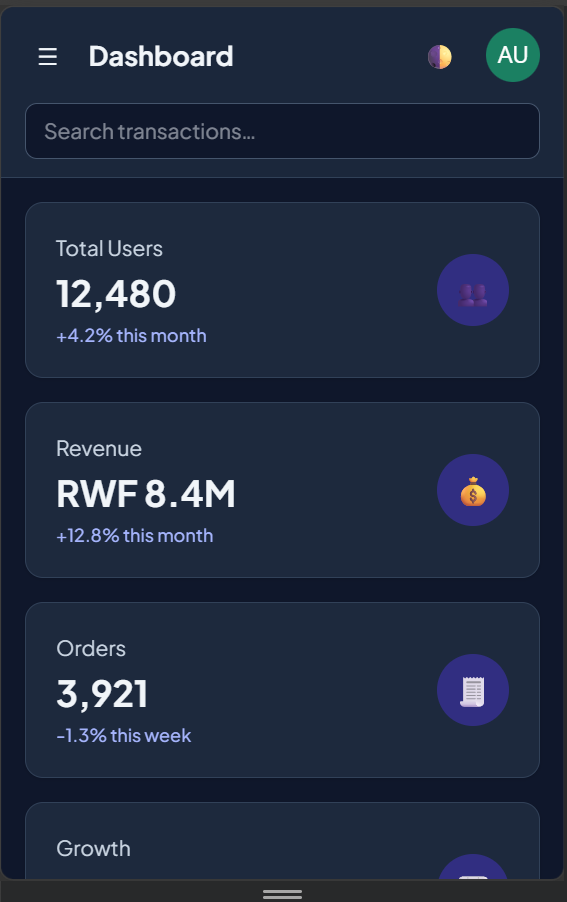
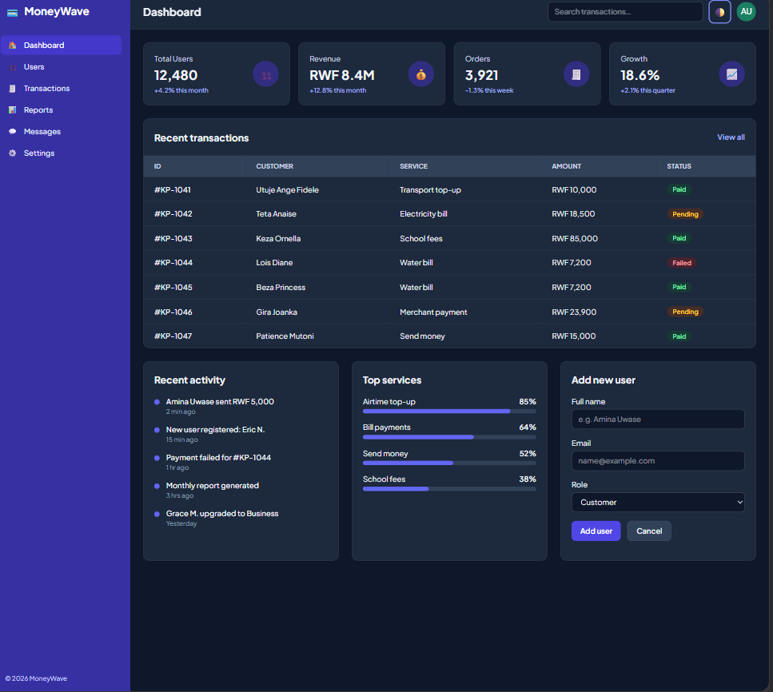

# MoneyWave Admin Dashboard

**Live site:** https://YOUR-LIVE-LINK-HERE

A responsive admin dashboard for a fictional mobile-money app, built with Tailwind CSS v4 + Vite and plain HTML.

## Screenshots
| Mobile (375px) | Desktop (1440px) |
|---|---|
|  |  |

## Run locally
```bash
npm install
npm run dev
```

## How I customized Tailwind
I installed Tailwind v4 with the official Vite plugin and a single `src/style.css` entry file. In the `@theme` block I added a custom `brand` colour palette (shades 50–900, a green/teal) and set "Plus Jakarta Sans" as the default sans font, so classes like `bg-brand-600` and `font-sans` use my identity everywhere. I also enabled class-based dark mode with `@custom-variant dark`, which a small JavaScript toggle controls and saves in localStorage. To keep the HTML readable I created reusable component classes with `@apply` inside `@layer components`: `.card` (panels and stat cards), `.btn-primary` and `.btn-secondary` (buttons with hover, focus and transition states), `.badge` with `.badge-paid`, `.badge-pending` and `.badge-failed` (status labels), `.nav-link` (sidebar links) and `.field-label` / `.field-input` (form controls). The layout uses mobile-first flex and grid utilities with `md:`, `lg:` and `xl:` breakpoints; the sidebar becomes a slide-in menu on mobile and the table scrolls sideways on small screens.

## Bonus features
Dark mode (`dark:` variant) and a mobile menu toggle.
